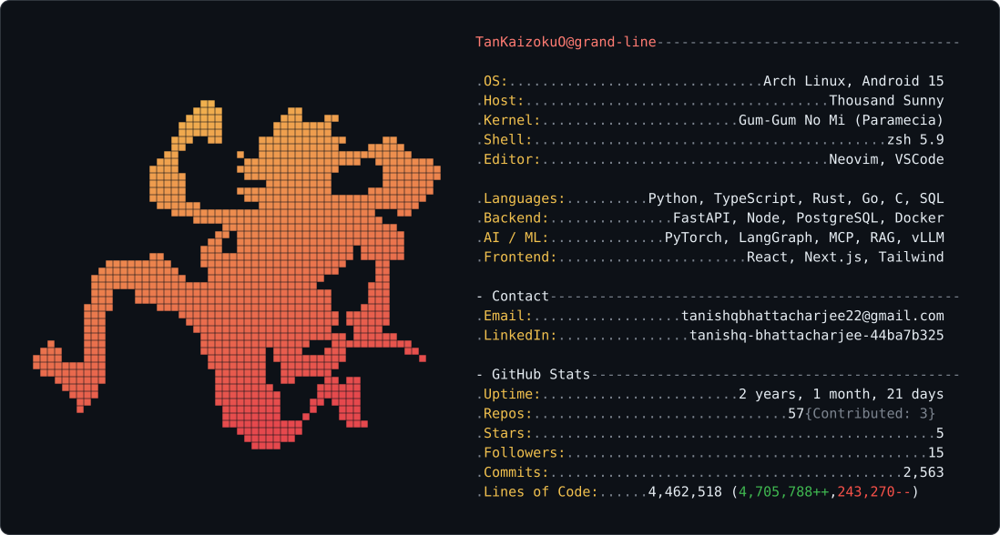

<picture>
  <source media="(prefers-color-scheme: dark)" srcset="./dark_mode.svg" />
  <source media="(prefers-color-scheme: light)" srcset="./light_mode.svg" />
  
</picture>

# Featured Projects

### [nakama_kun](https://github.com/TanKaizokuO/nakama_kun)
Verification-driven autonomous coding agent on LangGraph: validates every mutation against the workspace and grounds reports in an immutable evidence store.

### [research-assistant](https://github.com/TanKaizokuO/research-assistant)
Multi-source research agent on LangGraph: hybrid dense + sparse RAG over user PDFs, live arXiv/Semantic Scholar/web search, and page-attributed citations streamed over SSE.

### [BioMedical_QA](https://github.com/TanKaizokuO/BioMedical_QA)
Evidence-grounded biomedical QA: answers as atomic claims attributed to source passages, with a faithfulness verifier and a full attribution eval harness.

### [hue](https://github.com/TanKaizokuO/hue)
Wallpaper-to-theme engine with a CLI and GTK4 GUI: generates a palette, checks contrast, and applies it to detected Linux apps through journalled hooks with one-step undo.

### [Sibyl-SQL](https://github.com/TanKaizokuO/Sibyl_SQL)
Conversational Postgres agent: LangChain ReAct plans multi-step SQL while PostgreSQL Row-Level Security enforces access control at the database kernel.

### [backend-curriculum](https://github.com/TanKaizokuO/backend-curriculum)
Sixteen lessons that build one JSON API, from a raw socket to a deployed container. Python with FastAPI, parallel JavaScript/Express track.
